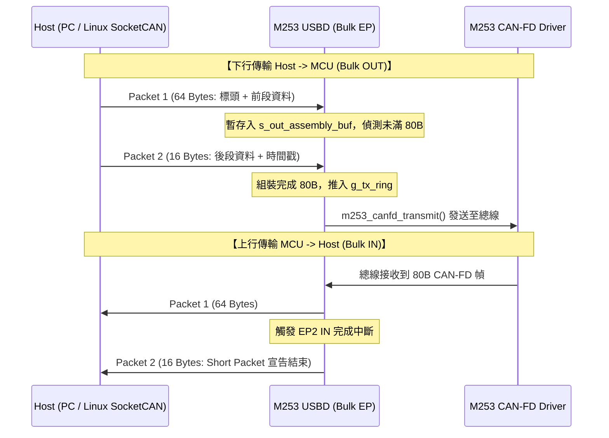

# Nuvoton M253LE3AE - candleLight FD (gs_usb) 韌體

本專案為新唐 **Nuvoton M253LE3AE**（Arm Cortex-M23 核心）量身打造的開源 **candleLight CAN-FD** 韌體。
完全相容 Linux 核心原生 **SocketCAN `gs_usb`** 驅動協定，並內建 Microsoft OS 1.0 (WCID) 描述符，在 Windows 10/11 下自動載入 WinUSB 驅動，實現**免手動安裝驅動、隨插即用**。

---

## 快速導覽目錄
1. [硬體規格與引腳定義](#1-硬體規格與引腳定義)
2. [程式碼架構與模組說明](#2-程式碼架構與模組說明)
3. [candleLight FD 封包格式詳解](#3-candlelight-fd-封包格式詳解)
4. [USB 64 位元組分段與組包機制](#4-usb-64-位元組分段與組包機制)
5. [Linux SocketCAN 使用教學](#5-linux-socketcan-使用教學)
6. [Windows (Python-can / Cangaroo) 使用教學](#6-windows-使用教學)
7. [除錯串口與 Log 監控](#7-除錯串口與-log-監控)
8. [Keil MDK 編譯與燒錄指南](#8-keil-mdk-編譯與燒錄指南)

---

## 1. 硬體規格與引腳定義

| 功能項目 | 引腳編號 | 說明 |
| :--- | :--- | :--- |
| **CAN0 RXD** | **PC.4** | 連接 CAN-FD 收發器之 RXD 引腳 |
| **CAN0 TXD** | **PC.5** | 連接 CAN-FD 收發器之 TXD 引腳 |
| **LED 指示燈** | **PB.0** | 單顆多功能狀態燈（待機滅、連線常亮、收發微閃、Identify 10Hz 頻閃） |
| **Debug UART** | **PA.2 (RXD), PA.3 (TXD)** | UART4 預設除錯輸出，**115200 bps**, 8-N-1 |
| **USB D- / D+** | **PA.12 / PA.13** | USB 2.0 Full-Speed (12 Mbps) 連接 PC 主機 |
| **120Ω 終端電阻** | - | **實體跳線（Jumper）** 控制，軟體協定宣告不支持 GPIO 切換 |
| **時脈來源** | - | 內部 48MHz HIRC，啟用 USB 1ms SOF 硬體自動微調（Crystal-less） |

---

## 2. 程式碼架構與模組說明

專案目錄結構如下：

```text
M253_candleLightFD/
├── Project/
│   └── Keil/
│       ├── M253_candleLightFD.uvprojx    <-- Keil MDK 專案檔 (Arm Compiler 6)
│       └── obj/                          <-- 編譯產出 (.hex, .bin, .axf)
├── Driver/
│   ├── CMSIS/                            <-- Cortex-M23 CMSIS 核心檔
│   ├── Device/Nuvoton/M253/              <-- M253 暫存器定義、啟動檔與 Scatter 檔
│   └── StdDriver/                        <-- 新唐標準周邊庫 (sys, clk, usbd, canfd, timer, uart, gpio)
├── Protocol/
│   ├── gs_usb.h                          <-- Linux SocketCAN gs_usb 協定資料結構定義
│   └── compiler.h                        <-- 跨編譯器巨集 (__packed, __aligned, struct_size)
└── User/
    ├── main.c                            <-- 主程式、中斷分派與 1 秒統計日誌
    ├── board_config.h                    <-- 板級引腳定義、緩衝區大小 (16 TX / 32 RX)
    ├── system_init.c / .h                <-- 48MHz HIRC、USB SOF Auto-trim、MFP 引腳設定
    ├── debug_log.h                       <-- 分級日誌巨集 (ERROR, INFO, DEBUG, DUMP)
    ├── descriptors.c / .h                <-- USB 設備/配置/字串描述符與 WCID 1.0 (WinUSB)
    ├── usbd_gs_can.c / .h                <-- USB 堆疊、EP0 廠商請求解析、64B 分段組包、環形佇列
    ├── m253_canfd.c / .h                 <-- Bosch M_CAN 驅動、混雜模式、動態波特率、TX Echo
    ├── timestamp.c / .h                  <-- TIMER0 1µs 連續硬體微秒時間戳計時器
    └── led.c / .h                        <-- PB.0 非阻塞多狀態指示燈狀態機
```

### 核心模組職責：
* **`usbd_gs_can.c`**：
  * 管理 EP0 控制傳輸，解析主機下發的波特率、模式設定與 Microsoft OS 描述符。
  * 管理 EP1 (Bulk IN) 與 EP2 (Bulk OUT) 的雙向環形緩衝區（TX 佇列 16 幀，RX 佇列 32 幀）。
  * 實作 64 位元組封包切片發送與接收組裝狀態機。
* **`m253_canfd.c`**：
  * 設定 Bosch M_CAN IP 的 Message RAM（Rx FIFO 0 元素與 Tx Buffer 皆為 64 位元組容量）。
  * 透過全域過濾器（GFC）開啟**混雜模式（Promiscuous Mode）**，接收總線上所有非匹配幀。
  * 維護 TX Echo 追蹤池，當封包成功送出後，回送帶有原始 `echo_id` 與時間戳的確認幀。
* **`timestamp.c`**：
  * 使用 TIMER0 配置為 1MHz 計數器，並處理 24 位元溢位，提供連續 32 位元微秒時間戳（`timer_get_us()`）。

---

## 3. candleLight FD 封包格式詳解

裝置與 PC 主機之間透過 USB Bulk 端點傳輸的二進位資料結構為 `struct gs_host_frame`。

### 3.1 封包記憶體佈局

```text
+-----------------------------------------------------------------------------------+
| Offset (Bytes) | 欄位名稱        | 大小 (Bytes) | 說明                             |
+----------------+-----------------+--------------+----------------------------------+
| 0 ~ 3          | echo_id         | 4 (uint32_t) | 發送確認標籤 (Rx 幀為 0xFFFFFFFF)|
| 4 ~ 7          | can_id          | 4 (uint32_t) | CAN ID 及旗標 (EFF, RTR, ERR)    |
| 8              | can_dlc         | 1 (uint8_t)  | 資料長度碼 DLC (0~15)            |
| 9              | channel         | 1 (uint8_t)  | 通道編號 (0 = CAN0)              |
| 10             | flags           | 1 (uint8_t)  | 幀型態旗標 (FD, BRS, ESI)        |
| 11             | reserved        | 1 (uint8_t)  | 保留位元 (0x00)                  |
| 12 ~ 75        | data[64]        | 64 (uint8_t) | 資料段負載 (CAN 2.0 僅用前 8B)   |
| 76 ~ 79        | timestamp_us    | 4 (uint32_t) | 32-bit 硬體微秒時間戳            |
+-----------------------------------------------------------------------------------+
總長度：CAN-FD 幀含時間戳共 80 位元組（經典 CAN 幀含時間戳共 24 位元組）
```

### 3.2 關鍵欄位旗標定義
* **`can_id` (32-bit)**：
  * `CAN_EFF_FLAG` (`0x80000000U`)：若此位元為 1，表示 29-bit 擴展幀（Extended ID）；若為 0 則為 11-bit 標準幀。
  * `CAN_RTR_FLAG` (`0x40000000U`)：遠程傳輸請求幀（Remote Transmission Request）。
  * `CAN_ERR_FLAG` (`0x20000000U`)：錯誤幀（Error Message Frame），此時低位元記錄 Bus-Off、Error Passive 等錯誤代碼。
  * 實際 ID 遮罩：標準幀 `can_id & 0x7FF`；擴展幀 `can_id & 0x1FFFFFFF`。
* **`flags` (8-bit)**：
  * `GS_CAN_FLAG_OVERFLOW` (`0x01`)：硬體 RX FIFO 溢位丟包旗標。
  * `GS_CAN_FLAG_FD` (`0x02`)：表示本幀為 **CAN-FD 幀**。
  * `GS_CAN_FLAG_BRS` (`0x04`)：Bit Rate Switch，資料段啟用高速波特率切換。
  * `GS_CAN_FLAG_ESI` (`0x08`)：Error State Indicator，節點處於 Error Passive 狀態。

---

## 4. USB 64 位元組分段與組包機制

由於 M253 的 USB 為 **Full-Speed (12Mbps)**，其 Bulk 端點的最大封包長度（`wMaxPacketSize`）硬體限制為 **64 位元組**。而 CAN-FD 幀長度為 **80 位元組**，因此必須進行分段與重組。



---

## 5. Linux SocketCAN 使用教學

在 Linux（如 Ubuntu、Debian、Raspberry Pi、Jetson）環境下，直接插入 M253 candleLight FD 即可免驅動辨識。

### 5.1 檢查裝置辨識狀態
打開終端機執行：
```bash
# 查看核心訊息確認 gs_usb 驅動已綁定
dmesg | grep -i gs_usb
# 預期輸出：gs_usb 1-1:1.0: Configuring for 1 interfaces

# 檢查系統產生的 can 網路介面
ip link show
# 應能看見 can0
```

### 5.2 啟動與設定 CAN 介面

#### 範例 A：啟動傳統 CAN 2.0（例如 500 kbps）
```bash
sudo ip link set can0 down
sudo ip link set can0 type can bitrate 500000
sudo ip link set can0 up
```

#### 範例 B：啟動 CAN-FD（仲裁段 500 kbps，資料段 2 Mbps）
```bash
sudo ip link set can0 down
sudo ip link set can0 type can bitrate 500000 dbitrate 2000000 fd on
sudo ip link set can0 up
```

#### 範例 C：啟動監聽模式（Listen-Only Sniffer，不發送 ACK）
```bash
sudo ip link set can0 down
sudo ip link set can0 type can bitrate 500000 dbitrate 2000000 fd on listen-only on
sudo ip link set can0 up
```

### 5.3 封包收發與診斷測試（使用 `can-utils`）
若系統尚未安裝 `can-utils`，請先安裝：
```bash
sudo apt update && sudo apt install -y can-utils
```

#### 1. 監聽接收總線封包 (`candump`)
```bash
# 即時印出所有接收到的封包（含微秒時間戳、顏色高亮）
candump -ca -td -tz can0
```

#### 2. 發送傳統 CAN 2.0 封包 (`cansend`)
```bash
# 發送 Standard ID 0x123，資料長度 4 bytes (11 22 33 44)
cansend can0 123#11223344

# 發送 Extended ID 0x18DAF110，資料長度 8 bytes
cansend can0 18DAF110#0102030405060708
```

#### 3. 發送 CAN-FD 封包（最大 64 位元組，含 BRS）
CAN-FD 語法使用兩個井號 `##`，緊接著 1 byte 旗標（`1` 表示啟用 BRS）：
```bash
# 發送 CAN-FD 64 位元組封包（啟用 BRS 高速切換）
cansend can0 123##100112233445566778899AABBCCDDEEFF00112233445566778899AABBCCDDEEFF00112233445566778899AABBCCDDEEFF00112233445566778899AABBCCDDEEFF
```

#### 4. 高速壓力發送測試 (`cangen`)
```bash
# 以間隔 1ms (-g 1) 連續產生隨機 CAN-FD 64 位元組封包 (-f -b)
cangen can0 -g 1 -f -b
```

#### 5. 查詢總線統計資訊與錯誤狀態
```bash
ip -details -statistics link show can0
```

#### 6. 關閉 CAN 介面
```bash
sudo ip link set can0 down
```

---

## 6. Windows 使用教學

在 Windows 10/11 下，M253 candleLight FD 透過內建的 **Microsoft OS 1.0 (WCID)** 描述符會自動辨識並載入系統內建的 `WinUSB` 驅動，不需要安裝任何第三方 .inf 驅動或執行 Zadig。

在裝置管理員中可看見：
`通用序列匯流排裝置 -> M253 candleLight FD USB`

### 6.1 使用 Python (`python-can`) 收發
安裝庫：
```bash
pip install python-can[gs_usb]
```

收發測試程式碼範例：
```python
import can
import time

# 建立 CAN-FD 匯流排連線 (仲裁段 500k, 資料段 2M)
bus = can.Bus(
    interface='gs_usb',
    channel=0,
    bitrate=500000,
    data_bitrate=2000000,
    fd=True
)

# 構造 64 位元組 CAN-FD 封包
msg = can.Message(
    arbitration_id=0x123,
    is_extended_id=False,
    is_fd=True,
    bitrate_switch=True,
    data=bytes(range(64))  # 0x00 ~ 0x3F
)

# 發送封包
bus.send(msg)
print("[TX] Sent 64-byte CAN-FD frame successfully!")

# 接收封包 (超時 2 秒)
print("[RX] Waiting for frames...")
recv_msg = bus.recv(timeout=2.0)
if recv_msg:
    print(f"[RX] ID: 0x{recv_msg.arbitration_id:X}, DLC: {recv_msg.dlc}, Data: {recv_msg.data.hex()}")
else:
    print("[RX] Timeout: No frame received.")

bus.shutdown()
```

### 6.2 使用 Cangaroo 開源上位機軟體
1. 下載並開啟 **Cangaroo** (支援 CAN-FD 的版本)。
2. 在連線設定中選擇介面為 **candleLight / gs_usb**。
3. 設定 Bitrate (如 500,000) 與 Data Bitrate (如 2,000,000)，勾選 **CAN-FD**。
4. 點擊 **Start Measurement** 即可直觀檢視總線報文。

---

## 7. 除錯串口與 Log 監控

板子上的 **PA.2 (RXD)** 與 **PA.3 (TXD)** 為硬體除錯串口（UART4）。

* **波特率**：`115200`
* **資料位**：`8`
* **同位檢查**：`None`
* **停止位**：`1`

### 典型開機與運作 Log 範例：
```text
========================================
  Nuvoton M253 candleLight FD (gs_usb)  
  HCLK: 48000000 Hz, CAN Core: 48000000 Hz
  CAN Pins: PC.4 (RXD), PC.5 (TXD)
  Debug Port: UART4 (PA.2/PA.3 @ 115200 bps)
========================================
[MAIN] Firmware initialization complete. Ready for host.
[USB] Cable Plugged In
[USB] Bus Reset
[USB] WCID: Compatible ID queried
[USB] WCID: Ext Property GUID queried
[USB] Host Byte Order: 0xEFBE0000
[USB] BREQ: DEVICE_CONFIG
[USB] BREQ: BT_CONST (fclk=48000000)
[USB] BREQ: BT_CONST_EXT
[CAN_CFG] Nominal Timing: BRP=6, Prop=3, Seg1=10, Seg2=2, SJW=1
[CAN_CFG] Data Timing: BRP=2, Prop=3, Seg1=6, Seg2=2, SJW=1
[CAN_CFG] Mode -> START (FD: 1, ListenOnly: 0, Loopback: 0)
[STATS] CAN RX: 154, TX: 154, Echo: 154 | USB IN: 308, OUT: 154 | Err: 0
```

---

## 8. Keil MDK 編譯與燒錄指南

### 8.1 專案開啟與建置
1. 使用 **Keil uVision5** 開啟專案檔：
   `M253_candleLightFD\Project\Keil\M253_candleLightFD.uvprojx`
2. 點擊 **Rebuild All (F7)**。
3. 編譯結果應為 **0 Error(s), 0 Warning(s)**。

### 8.2 命令列自動編譯 (PowerShell)
```powershell
& "C:\Users\tester\AppData\Local\Keil_v5\UV4\UV4.exe" -b "c:\Users\tester\Desktop\m253 socket can\M253_candleLightFD\Project\Keil\M253_candleLightFD.uvprojx" -o "build.log"
Get-Content "c:\Users\tester\Desktop\m253 socket can\M253_candleLightFD\Project\Keil\build.log"
```

### 8.3 韌體燒錄
* **Nu-Link 燒錄**：
  * 在 Keil 的 `Options for Target -> Debug` 中選擇 **Nuvoton Nu-Link Debugger**。
  * 點擊 **Download (F8)** 即可將韌體燒錄進 APROM（基底位址 `0x00000000`）。
* **直接使用產出的二進位檔**：
  * `Project\Keil\obj\M253_candleLightFD.bin`
  * `Project\Keil\obj\M253_candleLightFD.hex`

---

## 9. 模式切換與自動化測試驗證 (31/31 全數通過)

### 9.1 正常模式 (Normal Mode) vs 內部迴環 (Loopback Mode)
本韌體嚴格遵循 Linux SocketCAN `gs_usb` 標準協定規範，**絕非固定/寫死迴環**：
* **正常對外收發（預設）**：
  * 當 Host 端送出標準 `START` 指令（未帶 `GS_CAN_MODE_LOOP_BACK` 旗標）時，MCU 暫存器進入 `CCCR = 0x00000300, TEST.LBCK = 0`。
  * 實體引腳 **PC.5 (TXD)** 驅動外部 CAN 收發器發送，**PC.4 (RXD)** 即時接收實體匯流排封包。
* **內部迴環測試（自測）**：
  * 當 Host 端明確帶入 `GS_CAN_MODE_LOOP_BACK` 旗標時，暫存器啟用 `CCCR.TEST = 1, TEST.LBCK = 1, CCCR.MON = 0`，M_CAN 核心於晶片內部自我反饋，忽略 ACK 錯誤，供單板無外部總線時進行端到端自檢。

### 9.2 Bosch M_CAN Message RAM 精確分區架構
M253LE3AE 的 CAN-FD Message RAM 硬體上限為 **1024 位元組 (1 KB)**。本韌體實作非重疊、零浪費的緊湊分區配置：

| 元素區塊 | 元素數量 | 單一元素容量 | 區塊起始偏移 | 佔用位元組 | 說明 |
| :--- | :--- | :--- | :--- | :--- | :--- |
| **Rx FIFO 0** | 8 幀 | 72 Bytes (64B 負載 + 8B 標頭) | `0x000` | 576 Bytes | 接收總線上所有標準與擴展幀 |
| **Tx Event FIFO** | 4 筆 | 8 Bytes | `0x240` | 32 Bytes | 記錄發送事件 |
| **Tx Buffer** | 4 幀 | 72 Bytes (64B 負載 + 8B 標頭) | `0x260` | 288 Bytes | 支援 4 深度非阻塞發送佇列 |
| **總計佔用** | - | - | - | **896 Bytes** | **< 1024 Bytes 硬體上限 (安全裕度 128B)** |

### 9.3 自動化測試套件覆蓋 (34 項測試 100% PASS)
於 `tests/test_windows_loopback.py` 提供完整 pytest 測試套件，涵蓋：
* **經典 CAN 2.0 全部 9 種長度**：0, 1, 2, 3, 4, 5, 6, 7, 8 位元組逐一比對通過。
* **CAN-FD 全部 16 種標準 DLC 長度**：0, 1, 2, 3, 4, 5, 6, 7, 8, 12, 16, 20, 24, 32, 48, 64 位元組 (含 BRS 高速資料段切換) 逐一比對通過。
* **TIMER0 1µs 硬體時間戳**：連續單調遞增驗證通過。
* **UART4 串口遙測心跳**：115200bps 即時輸出 `BUF_DROP == 0` 與 `Err == 0`。
* **GET_STATE 與特徵報告 (TC-09)**：驗證讀回真實硬體 `state`、`TEC`、`REC` 與 `Features=0x000035BB`。
* **One-Shot 模式 (TC-10)**：驗證 `CCCR.DAR` 禁止自動重發機制。
* **BERR Reporting (TC-11)**：驗證匯流排協定錯誤中斷啟用與錯誤幀封裝。

---

## 10. 進階診斷與協定功能 (Advanced Diagnostics)

本韌體已完整支援 candleLight / Linux SocketCAN 標準中的 3 大進階特性：

1. **One-Shot 單次發送模式 (`GS_CAN_MODE_ONE_SHOT`)**：
   - 當 Host 啟用此旗標時，韌體自動設定 `CANFD0->CCCR |= CANFD_CCCR_DAR_Msk`（Disable Automatic Retransmission）。
   - 遭遇仲裁失敗或無節點回應 ACK 時，硬體不進行自動重發，便於單節點診斷與總線探測。
2. **控制器狀態與錯誤計數器查詢 (`GS_USB_BREQ_GET_STATE`)**：
   - 透過讀取 M253 `CANFD0->ECR` 暫存器，即時回傳發送錯誤計數器（`TEC`）與接收錯誤計數器（`REC`）。
   - 透過 `CANFD0->PSR` 狀態暫存器判定即時匯流排狀態（`ERROR_ACTIVE`、`ERROR_WARNING`、`ERROR_PASSIVE`、`BUS_OFF`、`STOPPED`）。
   - Linux 下執行 `ip -d link show can0` 可直接呈現即時錯誤計數。
3. **匯流排錯誤幀回報 (`GS_CAN_MODE_BERR_REPORTING`)**：
   - 當 Host 啟用此旗標時，開啟 M_CAN 的資料段與仲裁段協定錯誤中斷（`PEDE` / `PEAE`）。
   - 當發生 Stuff Error、Form Error、Ack Error、Bit Error、CRC Error 時，自動讀取 `LEC` / `DLEC` 並打包 Linux 標準 `CAN_ERR_PROT` / `CAN_ERR_ACK` / `CAN_ERR_CRTL` 錯誤幀發送給 Host。


